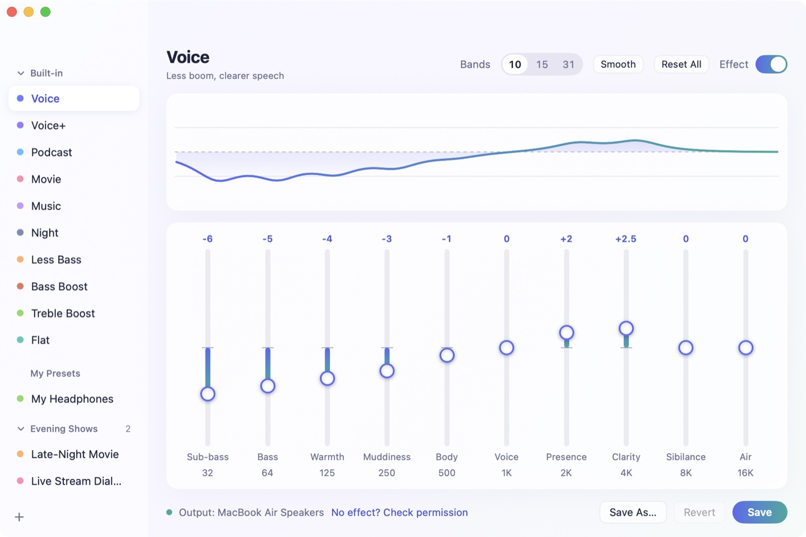
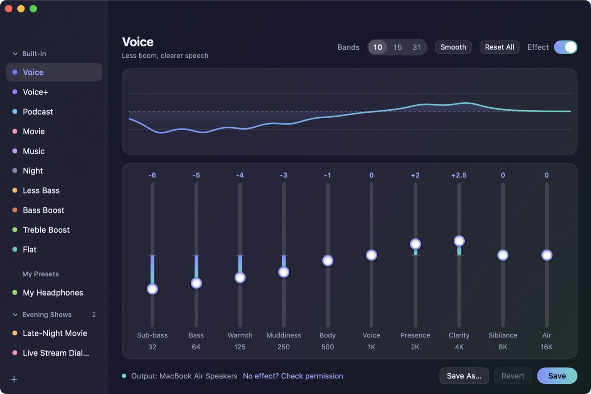
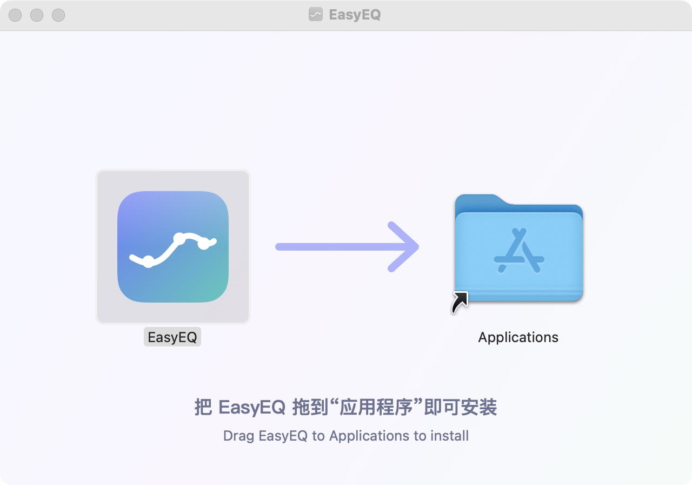
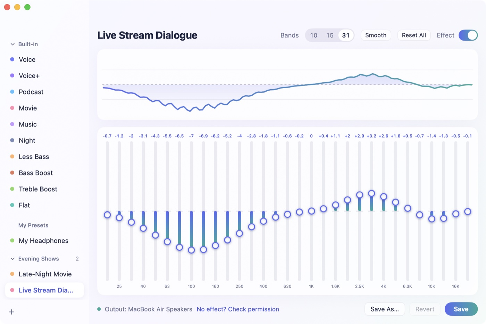
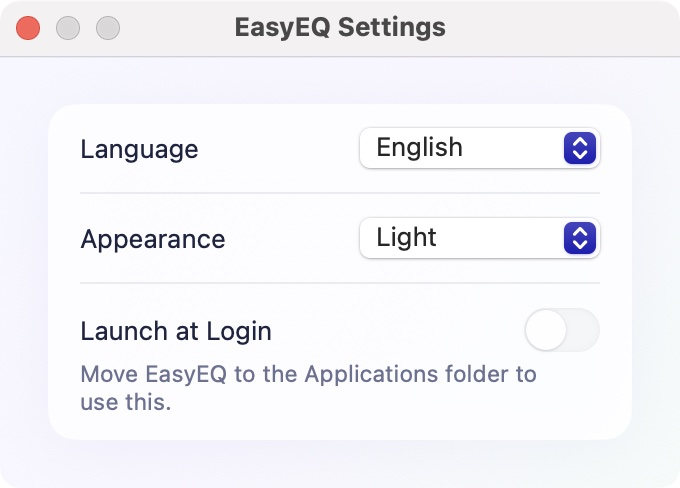

<div align="center">

# EasyEQ

**A simple, good-looking, completely free system-wide equalizer for Mac.**

**English** | [简体中文](README.zh-CN.md)

[](https://github.com/gzldc/EasyEQ/releases/latest)


[**⬇ Download the latest version**](https://github.com/gzldc/EasyEQ/releases/latest) · [Install guide](#install-step-by-step) · [FAQ](#faq--troubleshooting) · [Changelog](CHANGELOG.md)

 

</div>

---

## At a glance

| | |
|---|---|
| **What it is** | A native macOS app that applies an equalizer (EQ) to *all* sound your Mac plays — browsers, video sites, music and video players, calls. |
| **Who it's for** | Anyone who wants voices clearer or bass tamer without learning audio jargon. Especially good for muddy-sounding speakers such as the Apple Studio Display. |
| **Price** | Free. No trial, no time limit, no Pro version. |
| **License** | Open source, [MIT](LICENSE). |
| **Platform** | macOS 14.4 (Sonoma) or later, Apple silicon and Intel. |
| **Install** | Download `EasyEQ-<version>.dmg` from [Releases](https://github.com/gzldc/EasyEQ/releases/latest) and drag the app to Applications. |
| **Needs a driver?** | No. It uses macOS's built-in Core Audio Process Tap. No virtual sound card, no switching output devices. |
| **Permission** | System Audio Recording (asked once on first launch). Audio is processed locally in real time; nothing is recorded or uploaded. |
| **Languages** | English and Simplified Chinese (follows the system, or choose in Settings). |
| **Current version** | 0.2.0 — see the [Changelog](CHANGELOG.md). |

## Contents

- [Why EasyEQ](#why-easyeq)
- [Highlights](#highlights)
- [Compared with other apps](#compared-with-other-apps)
- [Requirements](#requirements)
- [Install, step by step](#install-step-by-step)
- [Quick start (2 minutes)](#quick-start-2-minutes)
- [User guide](#user-guide)
- [FAQ & troubleshooting](#faq--troubleshooting)
- [Privacy](#privacy)
- [Update & uninstall](#update--uninstall)
- [How it works](#how-it-works)
- [Build from source](#build-from-source)
- [Contributing](#contributing)
- [Changelog](#changelog)
- [License](#license)

## Why EasyEQ

I watch videos and live streams on a Mac Studio with the Studio Display speakers. The display already leans bass-heavy, so voices that are a bit muddy to begin with end up boomy and tiring. All I wanted was a **simple system-wide equalizer**: pull the bass down, lift the diction, save a few presets and switch between them.

Nothing I tried felt right: one had a daily paid countdown, one needed a driver plus manually switching the output device, and others only labelled bands "32, 64, 125…". So I built EasyEQ.

## Highlights

- **Completely free, no limits** — no trial, no 30-minutes-a-day countdown, no "upgrade to Pro". Open source (MIT).
- **No driver, no settings to change** — uses macOS's built-in system audio capture (Core Audio Process Tap). Grant permission once and it works; **no switching the output device** in Sound settings, no virtual audio device added to your system.
- **Readable** — every slider has a plain-language name: Sub-bass, Warmth, Muddiness, Presence, Clarity, Sibilance… you know where to drag without audio knowledge.
- **Made for clear voices** — 10 built-in presets. Voice and Voice+ cut the boom and bring speech forward for streams, classes and podcasts, alongside Podcast, Movie, Music, Night, Less Bass, Bass Boost, Treble Boost and Flat.
- **Drag and hear it live** — press and drag a slider; sound and curve change together. Double-click to reset. With 15 or 31 bands you can paint the whole curve in one stroke by dragging across the bands.
- **Groups and sharing** — organize your own presets into collapsible groups, and import / export presets as files to share.
- **Easy install** — download the DMG and drag the app into Applications; optionally launch at login.
- **What you save is what you hear** — saved presets sound exactly like what you heard, even after a restart.
- **Good-looking and light** — a soft glass design with light and dark appearances. Animations only play at the moment you act; otherwise the UI is completely still and costs almost nothing.
- **One-click recovery** — if macOS's audio service gets stuck, EasyEQ tells you and offers a **Repair System Audio** button, no restart needed.
- **English & Chinese** — follows the system language, switchable in Settings.
- **Private** — no network access, no data collection.

## Compared with other apps

| | **EasyEQ** | Sonora | Radioform | eqMac | FineTune | SoundSource |
|---|---|---|---|---|---|---|
| Price | **Free, unlimited** | EQ free; extras limited to 30 min/day | Free | Basic free; advanced EQ needs Pro | Free | Paid |
| Open source | **✅ MIT** | ❌ | ✅ GPL-3.0 | Partly (public source is an old version) | ✅ GPL-3.0 | ❌ |
| Installs an audio driver | **No** | No | Yes | Yes | No | — |
| Must switch output device manually | **No** | No | Yes | — | No | No |
| UI | **Window** | Window | Menu-bar popover | Menu bar | Menu bar | Menu bar |
| Bands | **10 / 15 / 31** | 10 / 20 and more | 10 (parametric) | 3 / 10 (Pro) | 10 | Per-app EQ |
| Plain-language band names | **✅** | — | ❌ | ❌ | ❌ | ❌ |
| Chinese UI | **✅** | ✅ | — | — | — | — |
| Focus | Simple, clear voices | Feature-rich | Lightweight, open | Long-standing EQ | Per-app volume | Pro audio routing |

> Compiled in October 2026 from each app's website and repository; "—" means not verified. Corrections via [Issues](https://github.com/gzldc/EasyEQ/issues) are welcome.
> If you want per-app volume, FineTune or SoundSource fit better. If you just want your whole Mac to sound easier on the ears, EasyEQ is the simplest.

## Requirements

- macOS **14.4 or later** (the Core Audio Process Tap API first shipped in 14.4).
- Apple silicon or Intel Mac (the app is a universal binary).
- About 5 MB of disk space.
- An administrator password is only needed if you ever use **Repair System Audio**.

## Install, step by step

**1. Download.** Open the [latest release](https://github.com/gzldc/EasyEQ/releases/latest) and download `EasyEQ-<version>.dmg` (for example `EasyEQ-0.2.0.dmg`). A `.zip` with the same app is also there if you prefer.

**2. Drag to Applications.** Double-click the DMG. A window opens — drag the EasyEQ icon onto the Applications folder, then eject the disk image.

<p align="center"></p>

**3. Open it the first time.** EasyEQ is not notarized by Apple yet (that needs a paid developer account), so on first launch macOS may say it *cannot verify the developer*:

1. Click **Done** (or **OK**) in that dialog.
2. Open **System Settings → Privacy & Security**.
3. Scroll down to the message about EasyEQ and click **Open Anyway**, then confirm.

You only do this once. (Since macOS 15, right-click → Open no longer bypasses this check; use **Open Anyway**.)

**4. Allow system audio.** EasyEQ asks for the **System Audio Recording** permission — click **Allow**. If you missed it, open **System Settings → Privacy & Security → Screen & System Audio Recording**, find the **System Audio Recording Only** list and turn on EasyEQ. This permission is what lets any app process sound played by other apps; EasyEQ does not record anything.

**5. Done.** Play something and pick a preset. The footer shows `Output: <your device>` with a coloured dot when processing is running.

## Quick start (2 minutes)

1. **Play some audio** — a video, a stream, music.
2. **Click a preset** on the left. Try **Voice** for talking, **Movie** for films, **Music** for songs. The change is instant.
3. **Compare** — flip the **Effect** switch (top right) off and on to hear the difference.
4. **Fine-tune** — drag any slider up (louder) or down (quieter). Double-click a slider to put it back to 0.
5. **Keep it** — click **Save As…** and give it a name. It appears under **My Presets**.
6. **Close the window** — the EQ keeps working while EasyEQ stays in the Dock. Quit with **⌘Q** to turn it off completely.

## User guide

### The window

| Area | What it does |
|---|---|
| **Sidebar (left)** | *Built-in* presets, *My Presets*, and your groups. Click to apply. **↑ / ↓** move between presets. The **+** button at the bottom opens *New Preset*, *New Group* and *Import Presets…*. |
| **Header** | Preset name and description, **Bands** (10 / 15 / 31), **Smooth**, **Reset All**, and the **Effect** switch. |
| **Curve** | The combined frequency response of all bands, updated live. |
| **Sliders** | One per band, ±12 dB. The number above is the gain; below are a plain-language name and the frequency. |
| **Footer** | Output device and status, permission hint, **Save As…**, **Revert**, **Save**. |

### What the slider names mean

| Name | Frequency range | Turn it **down** when… | Turn it **up** when… |
|---|---|---|---|
| Sub-bass | below 45 Hz | the room rumbles | you want deep impact |
| Bass | 45–90 Hz | music feels boomy | music feels thin |
| Warmth | 90–180 Hz | voices sound thick | voices sound cold |
| Muddiness | 180–350 Hz | voices sound muffled, "boxy" | (rarely needed) |
| Body | 350–700 Hz | voices sound honky | voices sound hollow |
| Voice | 700 Hz–1.4 kHz | voices sound nasal | voices sound distant |
| Presence | 1.4–2.8 kHz | speech is harsh | speech lacks definition |
| Clarity | 2.8–5.6 kHz | it's piercing | words are hard to make out |
| Sibilance | 5.6–11 kHz | "s" sounds hiss | it sounds dull |
| Air | above 11 kHz | there is hiss | you want sparkle |

**Tip for unclear voices:** lower Sub-bass → Muddiness a few dB and raise Presence / Clarity by 2–3 dB. That's what the **Voice** preset does.

### Built-in presets

Values are for the 10-band layout (32 Hz → 16 kHz), in dB.

| Preset | Use it for | 32 | 64 | 125 | 250 | 500 | 1K | 2K | 4K | 8K | 16K |
|---|---|---|---|---|---|---|---|---|---|---|---|
| **Voice** | Streams, lectures, calls | -6 | -5 | -4 | -3 | -1 | 0 | +2 | +2.5 | 0 | 0 |
| **Voice+** | Very muddy voices | -10 | -9 | -7 | -5 | -2 | 0 | +3 | +3 | 0 | -1 |
| **Podcast** | Clear speech, softer "s" | -6 | -4 | -2 | -1 | 0 | +1 | +3 | +2 | -1 | -2 |
| **Movie** | Clear dialogue, a little bass | +2 | +2 | 0 | -1 | 0 | +1 | +2 | +2 | +1 | 0 |
| **Music** | Gentle lift to bass and treble | +3 | +2 | +1 | 0 | -1 | -1 | 0 | +1 | +2 | +2 |
| **Night** | Dialogue at low volume | -8 | -6 | -4 | -2 | 0 | +1 | +2 | +2 | 0 | -1 |
| **Less Bass** | Remove boom and mud | -8 | -7 | -5 | -3 | -1 | 0 | 0 | 0 | 0 | 0 |
| **Bass Boost** | Fuller bass | +5 | +5 | +4 | +2 | 0 | 0 | 0 | 0 | 0 | 0 |
| **Treble Boost** | Brighter, crisper | 0 | 0 | 0 | 0 | 0 | +1 | +2 | +3 | +4 | +4 |
| **Flat** | No processing | 0 | 0 | 0 | 0 | 0 | 0 | 0 | 0 | 0 | 0 |

Built-in presets can't be overwritten. Change one and click **Save As…** to keep your version.

### Bands: 10, 15 or 31

- **10 bands** (default) — 32, 64, 125, 250, 500, 1K, 2K, 4K, 8K, 16K Hz. Easiest.
- **15 bands** — 25 Hz to 16 kHz in 2/3-octave steps. More control.
- **31 bands** — 20 Hz to 20 kHz in 1/3-octave steps. Finest control; best edited by painting (below).

Switching converts your current curve to the new layout, so the sound barely changes. Each preset remembers its own band count.

### Editing: drag, paint, hover, scroll

<p align="center"></p>

- **Drag a slider** up or down. Sound and curve update while you drag.
- **Paint** — press anywhere in the slider area and drag sideways: every band you cross is set to the pointer's height. Fast strokes never skip a band. A mostly vertical drag only changes the band you started on.
- **Hover** a band to highlight it and see a readout like `1.25K · +3.0 dB`.
- **Scroll** (mouse wheel or two-finger swipe) over a band to nudge it by 0.5 dB per step.
- **Double-click** a slider to reset that band to 0.
- **Smooth** gently evens out a jagged curve — handy after painting 31 bands.
- **Reset All** sets every band to 0. **Revert** undoes all unsaved changes.
- With 31 bands only every other frequency is labelled to avoid clutter; hover to see the rest.

### Saving your own presets

- **Save** (⌘S) — overwrite the selected preset of yours.
- **Save As…** (⇧⌘S) — save the current sliders as a new preset.
- **New Preset** (⌘N, or **+ → New Preset**) — start a new preset.
- **Right-click a preset** for **Rename…**, **Move to Group**, **Export…** and **Delete** (deleting asks for confirmation).

### Groups

Groups are optional; by default your presets are listed flat under **My Presets**.

1. Click **+ → New Group** and name it.
2. Put presets in it: drag a preset onto the group header, or right-click a preset → **Move to Group → <group>**.
3. Click a group header to collapse or expand it. **Built-in** can be collapsed too. Collapsed state is remembered.
4. Right-click a group header for **Rename Group…**, **New Preset Here** and **Delete Group**.

Deleting a group **never deletes its presets** — they move back to *My Presets*.

### Import and export (sharing presets)

- **Export:** right-click a preset → **Export…** and save a `.json` file.
- **Import:** **+ → Import Presets…** and pick one or more `.json` files. Name clashes get a suffix (e.g. `Voice 2`); broken files are reported and skipped without affecting the others.

The file format is plain JSON:

```json
{
  "formatVersion" : 1,
  "id" : "B3C1D17B-7CF3-4CF0-9DE5-1B4F19B7526B",
  "name" : "My Voice",
  "settings" : {
    "layout" : 10,
    "gains" : [-6, -5, -4, -3, -1, 0, 2, 2.5, 0, 0]
  }
}
```

`layout` is 10, 15 or 31 and `gains` has exactly that many values in dB, clamped to −12…+12.

### Keyboard shortcuts

| Shortcut | Action |
|---|---|
| ⌘N | New preset |
| ⌘S | Save |
| ⇧⌘S | Save As… |
| ⌘E | Turn the effect on / off |
| ↑ / ↓ | Previous / next preset in the sidebar |
| ⌘, | Settings |
| ⌘W | Close the window (EQ keeps running) |
| ⌘Q | Quit (sound returns to normal) |

### Settings

<p align="center"></p>

Open with **EasyEQ → Settings…** or **⌘,**.

- **Language** — Follow System, English, or 中文.
- **Appearance** — Follow System, Light, or Dark.
- **Launch at Login** — start EasyEQ automatically when you log in, so the EQ is always on. Available once EasyEQ is in the Applications folder.

### Status messages in the footer

| Message | Meaning | What to do |
|---|---|---|
| `Output: <device>` | Running normally. | Nothing. |
| `Starting…` | Connecting to the output device. | Wait a second. |
| `No effect? Check permission` | Sound may be passing through unprocessed. | Click it and enable System Audio Recording for EasyEQ. |
| `Audio processing isn't running.` + **Retry** | Starting failed. | Click **Retry**. |
| `The system audio service isn't responding.` + **Retry** / **Repair System Audio** | macOS's audio service (`coreaudiod`) is stuck. | Click **Repair System Audio** (see FAQ). |

## FAQ & troubleshooting

**I hear no difference.**
Check that the **Effect** switch is on and that you didn't pick **Flat**. If the footer says `No effect? Check permission`, open System Settings → Privacy & Security → Screen & System Audio Recording → **System Audio Recording Only** and turn on EasyEQ, then quit and reopen EasyEQ.

**macOS says it can't verify the developer / the app is damaged.**
See [Install step 3](#install-step-by-step): System Settings → Privacy & Security → **Open Anyway**. If macOS reports the app as "damaged" (usually because a download tool added a quarantine flag), you can run `xattr -dr com.apple.quarantine /Applications/EasyEQ.app` in Terminal and open it again.

**My Mac suddenly has no sound and EasyEQ says "The system audio service isn't responding".**
macOS's own audio service (`coreaudiod`) is stuck — typically after an audio device's driver restarted mid-playback (we have seen this with USB audio devices such as the Studio Display). Click **Repair System Audio** in EasyEQ's footer and enter an administrator password in the macOS dialog; sound comes back in a few seconds and EasyEQ reconnects by itself. EasyEQ never sees the password — the dialog is the system's. Alternatively run this in Terminal, or restart the Mac:

```bash
sudo killall coreaudiod
```

**I unplugged headphones / switched speakers.**
EasyEQ follows the system's default output automatically. If a device's driver drops out, EasyEQ steps aside at once (your sound plays unprocessed) and reconnects when the device is back.

**Does it add latency or change the sound when "off"?**
Processing is local with a small buffer, so lip-sync stays right. With **Flat** selected or the **Effect** switch off, it sounds the same as without the app.

**Will it distort if I push sliders to +12?**
No. EasyEQ lowers the overall level automatically and uses a limiter, and all changes are smoothed so there are no clicks.

**Can I EQ one app only (e.g. just the browser)?**
Not at the moment; EasyEQ processes all system audio. Per-app tools like FineTune or SoundSource do that.

**Can I use it together with another EQ (Radioform, eqMac, Sonora…)?**
Quit them while using EasyEQ, and uninstall virtual audio drivers you no longer use, so only one app processes the sound.

**Does it work with Bluetooth headphones / AirPods / HDMI / USB DACs?**
Yes — anything macOS uses as the default output device.

**Does it run in the menu bar?**
No, it's a normal window app with a Dock icon. Close the window and the EQ keeps running.

**Is it notarized / signed?**
It is ad-hoc signed and not yet notarized. The full source is here and every release is built by GitHub Actions from the tagged commit ([release workflow](.github/workflows/release.yml)).

## Privacy

- No network access, no analytics, no accounts.
- Audio is processed in memory in real time and immediately played back; it is never recorded, saved or sent anywhere.
- Your presets and settings stay on your Mac (see [where data is stored](#where-your-data-is-stored)).

## Update & uninstall

**Update:** download the new DMG and drag EasyEQ to Applications again, choosing **Replace**. Your presets and settings are kept. macOS may ask for the System Audio Recording permission again after an update — that's expected.

### Where your data is stored

| What | Where |
|---|---|
| Your presets | `~/Library/Application Support/EasyEQ/Presets/<id>.json` |
| Groups | `~/Library/Application Support/EasyEQ/groups.json` |
| Settings (language, appearance, last selection…) | macOS defaults domain `app.easyeq.EasyEQ` |

**Uninstall:**

1. If you turned on **Launch at Login**, turn it off in EasyEQ's Settings first.
2. Quit EasyEQ (⌘Q) and move `EasyEQ.app` from Applications to the Trash.
3. Optional — remove your presets and settings:

```bash
rm -rf ~/Library/Application\ Support/EasyEQ
```

```bash
defaults delete app.easyeq.EasyEQ
```

4. Optional — remove the permission entry in System Settings → Privacy & Security → Screen & System Audio Recording.

## How it works

- A **Core Audio Process Tap** (macOS 14.4+) captures all system audio and mutes the originals. EasyEQ processes the captured audio and plays it through a private aggregate device on the current default output device — no driver, no virtual sound card, nothing changes in Sound settings.
- Each band is an **RBJ peaking biquad** filter, applied in series (Q 1.41 / 2.1 / 4.3 for 10 / 15 / 31 bands), followed by automatic headroom and a limiter. The real-time audio thread never allocates or locks; gain changes are ramped.
- All Core Audio setup and teardown runs on a background queue with a watchdog, so a stuck system audio service can't freeze the UI. Device-alive and device-list listeners tear the pipeline down as soon as the output device disappears.
- Code layout:

| Path | Contents |
|---|---|
| `Sources/EasyEQCore` | Pure logic: band layouts, presets, groups, editing, painting, settings, localization (`Resources/*.lproj`). |
| `Sources/EasyEQAudio` | Core Audio tap, aggregate device, EQ processor, engine lifecycle, system-audio repair. |
| `Sources/EasyEQ` | SwiftUI app and views. |
| `Tests/` | Swift Testing suites for core and audio logic. |
| `scripts/` | `bundle.sh`, `package.sh`, `sign.sh`, icon and DMG-background generators. |
| `.github/workflows/` | `ci.yml` (tests), `test-build.yml` (test DMGs), `release.yml` (releases). |

## Build from source

Requires Xcode 16 or later (Swift 6 toolchain) on macOS 14.4+.

```bash
git clone https://github.com/gzldc/EasyEQ.git && cd EasyEQ
```

```bash
swift test
```

```bash
scripts/bundle.sh
```

`scripts/bundle.sh` builds `dist/EasyEQ.app` (universal binary). To build the zip and the styled DMG:

```bash
scripts/package.sh 0.2.0
```

- The `.dmg` needs [dmgbuild](https://github.com/dmgbuild/dmgbuild): `python3 -m venv .build/dmgvenv && .build/dmgvenv/bin/pip install dmgbuild`, then put `.build/dmgvenv/bin` on your `PATH` (or just `pip install dmgbuild`).
- Signing is ad-hoc by default. Set `SIGN_IDENTITY` to sign with your own certificate. If your keychain has a self-signed code-signing identity named `EasyEQ Local Signing`, the scripts use it automatically, so rebuilds don't keep asking for the system-audio permission.
- App icon: `swift scripts/make-icon.swift /tmp/AppIcon.iconset && iconutil -c icns /tmp/AppIcon.iconset -o Resources/AppBundle/AppIcon.icns`. Six designs are built in — choose with `--design A|B|C|D|E|F` (default A; previews in [`docs/images/icon-options/`](docs/images/icon-options/)).
- Installer background: `swift scripts/make-dmg-background.swift /tmp/dmgbg && tiffutil -cathidpicheck /tmp/dmgbg/background.png /tmp/dmgbg/background@2x.png -out Resources/DMG/background.tiff`.

### Test builds and releases

- **Test builds:** pushing any branch other than `main` (or running **Test build** manually in the Actions tab) builds a DMG and zip as downloadable run artifacts (kept 14 days), versioned `0.0.0-test.<run number>`. Nothing is published to Releases.
- **Releases:** pushing a tag `vX.Y.Z` builds and publishes a release with `EasyEQ-X.Y.Z.dmg` and `.zip`. Tags with a `-` (e.g. `v0.3.0-beta.1`) become pre-releases.

## Contributing

Bug reports, preset ideas, translations and pull requests are welcome — please open an [Issue](https://github.com/gzldc/EasyEQ/issues) first for larger changes. Run `swift test` before sending a PR. UI strings live in `Sources/EasyEQCore/Resources/<language>.lproj/Localizable.strings`; adding a language means adding one more `.lproj` folder.

## Changelog

See [CHANGELOG.md](CHANGELOG.md). Downloads are on [Releases](https://github.com/gzldc/EasyEQ/releases).

## License

[MIT](LICENSE) © 2026 shishuai
